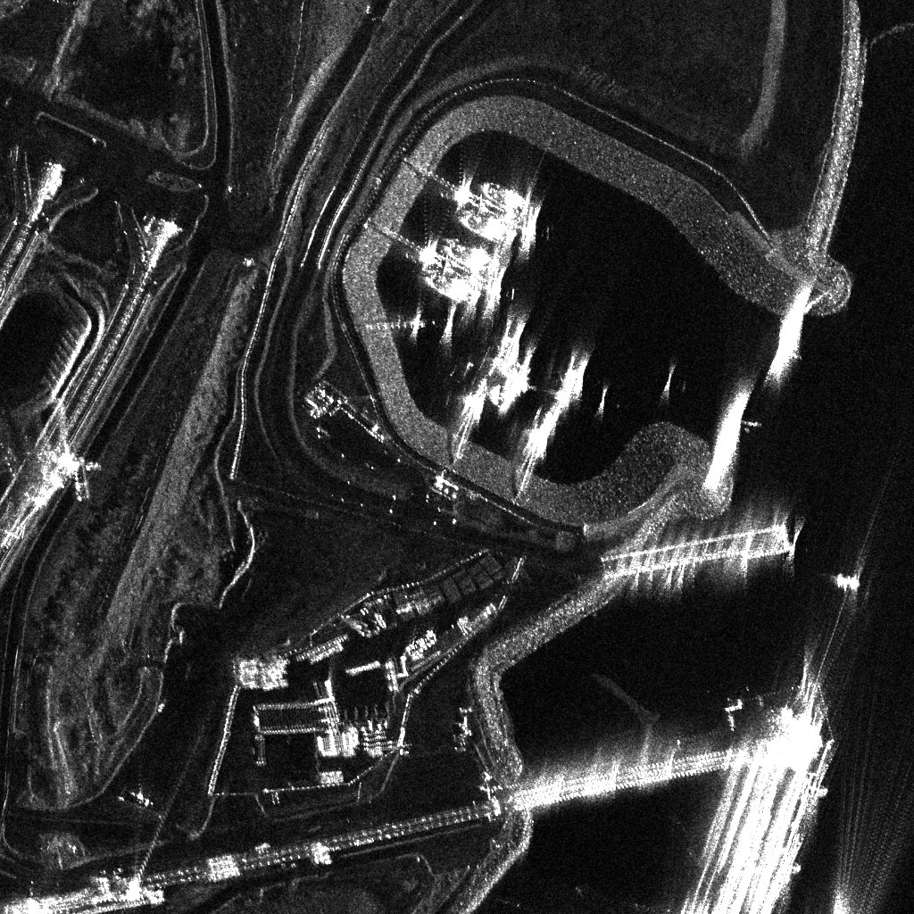
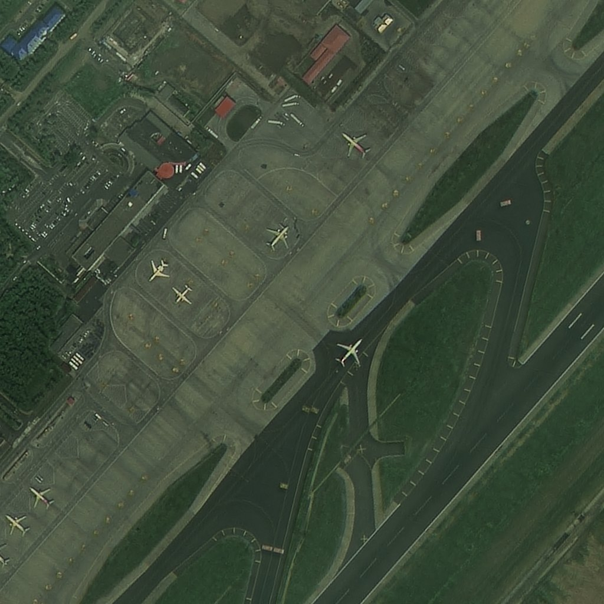
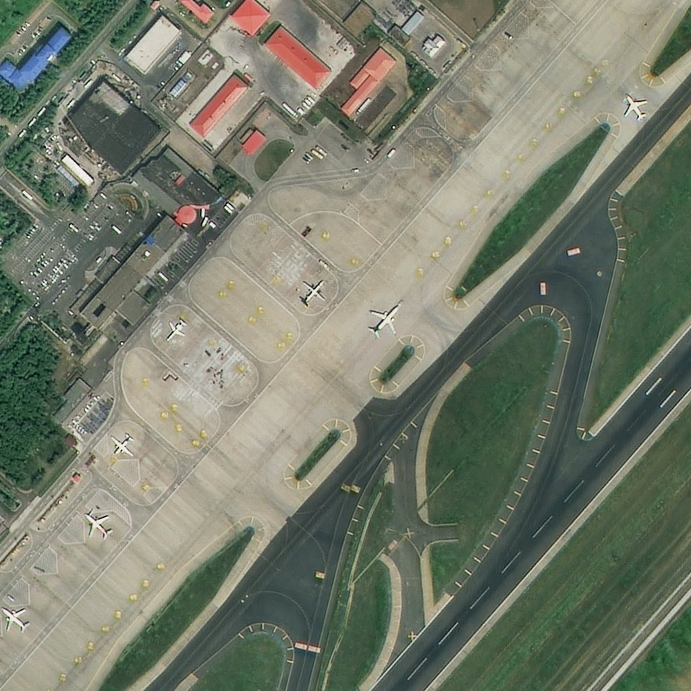
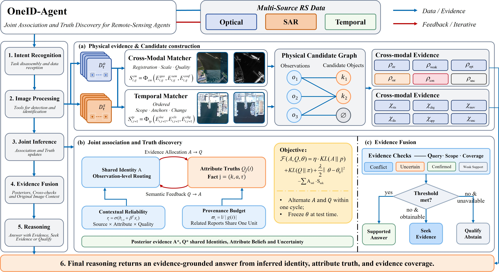

<div align="center">
  <h1 align="center">[ICLR 2027 · Under Review] OneID: One Observation, One Identity</h1>
  <h3 align="center">Joint Association and Truth Discovery for Remote-Sensing Agents</h3>
</div>

<div align="center" style="margin-top:10px;">

**Anonymous authors**  
*Paper under double-blind review*

[](LICENSE)
[](https://www.python.org/downloads/)
[](scripts/ci/run_contract_tests.py)


<em><sup>Manuscript and appendix are withheld during double-blind review.</sup></em>

</div>

OneID is an agent-based interpretation system for paired optical (RGB) and SAR remote-sensing imagery. A language-model agent plans multi-step tool use over a registry of detection, segmentation, change-detection, GIS and drawing tools; the cross-modal answer is produced by **DS+VI**, a shared-identity engine that pairs RGB and SAR detections at the object level, decides whether two detections describe the *same* object, and assembles a single answer whose evidence state is explicit.

The design follows one rule: **one observation, one identity**. Every claim extracted from a detection — existence, size, position, category — hangs on a single latent identity, so contradicting evidence revises that identity and moves all of its claims together instead of silently splitting one detection across two objects. Physical candidate constraints bound the admissible associations, and provenance budgets stop related tool reports from dominating the vote.

This repository contains the agent runtime, the tool service, the DS+VI engine, a Gradio UI, evaluation and fine-tuning scripts, and the frozen ground-truth protocol behind the reported numbers. It ships **no imagery, detections or ground truth**.

<p align="center">
  
  
</p>
<p align="center">
  
  
  <br>
  <em>Top: one harbour, two sensors — the same ships have to be paired across optical and SAR.</em><br>
  <em>Bottom: a temporal pair — aircraft move between acquisitions, so identity is re-established per timestamp.</em>
</p>

---

## 📢 Latest Updates

- **Nov-05-2026** Initial release: agent runtime, tool service (21 online tools + 2 in-process GeoTIFF tools), six skills, DS+VI engine, Gradio UI, CLI chat loop, evaluation and SFT scripts.
- **Nov-05-2026** Ground-truth construction frozen in [`scripts/eval/gt_protocol.py`](scripts/eval/gt_protocol.py) (`GT_PROTOCOL_VERSION = "1.0"`); the version is stamped into every evaluation run.
- **Nov-05-2026** Contract tests, four end-to-end suites and the tool-smoke harness added; `skill → controller → tool` is exercised over real HTTP.

---

## 🛠️ Architecture

OneID keeps planning and execution apart. The agent plans, the controller dispatches, and each tool is one worker process that can live in its own conda environment. That split matters here: segmentation, change detection and detection workers need mutually incompatible dependency pins.



Every worker exposes the same three endpoints — `POST /worker_generate`, `POST /tool_instruction`, `POST /worker_get_status` — so the agent loop does not change when a tool is added. Skills are multi-tool procedures registered the same way; the agent can call `CrossModalMatchSkill` without knowing which workers it drives.

### 🧰 Tool registry

| Group | Tools |
| --- | --- |
| Detection & segmentation | `ObjectDetection`, `SmallObjectDetection`, `DenoDetV2` (SAR), `SegmentObjectPixels`, `TextToBbox`, `CountGivenObject` |
| Change & time | `ChangeDetection` |
| GIS | `AddPoisLayer`, `ComputeDistance`, `GetAreaBoundary`, plus the in-process `GetBboxFromGeotiff` and `DisplayOnGeotiff` |
| Interpretation | `ImageDescription`, `RegionAttributeDescription`, `BaseModel` |
| Cross-modal | `CrossModalInterpret` |
| Drawing & utilities | `DrawBox`, `AddText`, `Plot`, `Calculator`, `Solver`, `GoogleSearch` |
| Orchestration | `SkillExecutor` |

Skills: `CrossModalMatchSkill` (target-level RGB/SAR pairing), `CrossModalTaskSkill` (task-level reasoning over matching evidence), `ObjectDetectSelectSkill`, `ObjectMeasureSkill`, `ObjectVisualOutputSkill`, `SAREvidenceExtractSkill`.

Checkpoints are wired through `tool_server/utils/paths.py` (`OBJECT_DETECTION_*`, `SAM_*`, `TEXT_TO_BBOX_*`, `CHANGE_DETECTION_MODEL_BASE`, `DENO_DET_V2_*`, …).

### Repository layout

| Path | Contents |
| --- | --- |
| `app/` | Gradio application (`app/app.py`, port 4444) |
| `tool_server/tool_workers/` | Worker implementations, controller, skills and the tool manager |
| `tool_server/tf_eval/` | Agent runtime, prompt building, trajectory tasks, evaluator |
| `DS_VI/` | `models/ds_fusion` (D-S pairing), `models/shared_identity` (evidence inference), `models/cascade` (assembly), `models/cross_modal` (task outputs), `models/opt` (optional OT association) |
| `scripts/eval/` | Evaluation entry points and the frozen GT protocol |
| `scripts/ci/` | Contract runner and the four end-to-end suites |
| `scripts/tools_test/` | One test case per registered tool and skill |
| `tests/contract/` | Public `CrossModalInterpret` contract and evidence-pipeline tests |
| `docs/` | Extra developer documentation (`docs/development.md`) |

### 🧠 Cross-modal interpretation (DS+VI)

`CrossModalInterpret` pairs RGB and SAR detections for one target class and answers one of five tasks: `crosscheck_exists`, `select_largest`, `select_highest_score`, `joint_scene`, `distance_largest_smallest`.

| `mode` | What runs | When |
| --- | --- | --- |
| `shared_identity` (default) | D-S pairing → shared-identity evidence → cascade assembly | normal operation |
| `vi_only` | shared-identity graph only | D-S stage failed, or too many observations |
| `candidate_graph` | candidate graph + physical priors, no inference | diagnostics |
| `legacy_hard` | legacy geometric matching | baseline / fallback |

The evidence layer reports a verdict per object in the four-valued state of the paper — `Confirmed`, `Weak Support`, `Conflict`, `Uncertain` — surfaced to callers as `vi_status`.

Degradation is always explicit: the response carries `mode`, `degraded` and `degrade_reason`. `ONEID_DEFAULT_MODE=legacy_hard` switches the default back.

Online capability is intentionally narrower than the offline experiments: only `category`-level evidence is available (no colour, size or orientation attributes), the temporal (static/moved) family is not part of the online path, and registration is fixed to `identity`. These limits are stated in the tool description and in `structured.capability`.

Configuration lives in `tool_server/tool_workers/online_workers/configs/ds_vi/`: `online_match.json` (detection-fusion side) and `runtime_online.yaml` (shared-identity side, a copy of `DS_VI/configs/shared_identity/runtime_best.yaml` with contextual reliability disabled).

---

## 🏷️ Benchmark and annotation pipeline

RSTIBench tests two things an agent cannot fake: whether tool calls execute correctly, and whether the objects they report are the objects actually present. The pipeline has four stages.

1. **Paired inputs.** Optical–SAR pairs (`match_images/task4_*.png`) and temporal pairs (`time_images/task5_*.png`), each kept in its own image directory next to the tool output and the truth.
2. **Tool stage.** Detections come from the same workers the agent calls and are stored as `{"detections": [...]}` JSON under `0_tool_json/`, so an evaluation measures the deployed path rather than an offline reimplementation.
3. **Independent annotation.** Object identities and attribute truths are annotated without reference to tool output. The context-conditioned reliability `θ` shipped in `DS_VI/configs/shared_identity/artifacts/contextual_theta_v1.json` was calibrated on 12,028 independently annotated claims over 7 modality–attribute channels.
4. **Frozen ground truth.** `scripts/eval/gt_protocol.py` owns label aliases, geometry primitives, match weights and the greedy pairing, and imports no interpreter or DS+VI code. Changing any constant there means changing the metric, so it requires bumping `GT_PROTOCOL_VERSION`.

The evaluator then builds object-level GT from the RGB and SAR boxes (IoU protocol by default, hybrid as a sensitivity check) and compares `rgb_only`, `sar_only`, `cross_modal` and `cross_modal_confirmed_only` against that same GT with modality-aware boxes.

---

## 📊 Benchmark evaluation

Evaluation runs at two granularities.

**Agent trajectories** (`tool_server/tf_eval`, driven by the `rsagent` task):

| Regime | Script | What it measures |
| --- | --- | --- |
| Step-by-step | `scripts/eval/eval_step.sh` | next-action quality over n steps from the full interaction history; tools are not executed |
| End-to-end | `scripts/eval/eval_e2e.sh` | full autonomous loop against the live controller and worker pool: tool choice, argument binding, recovery |
| Skill ablation | `scripts/eval/skill_eval/skill_eval.sh` | `no_skill` / `auto_skill` / `oracle_skill` on identical trajectories |

**Cross-modal interpretation** (`scripts/eval/eval_multisource_detection.py`):

| Axis | Values |
| --- | --- |
| Modality | `rgb_only`, `sar_only`, `cross_modal`, `cross_modal_confirmed_only` |
| Task | `crosscheck_exists`, `select_largest`, `distance_largest_smallest`, `joint_scene` |
| Metrics | AP, precision/recall/F1 at IoU 0.5, confirmed precision/recall/F1, distance MAE with absolute and relative thresholds, per-class breakdowns, cross-modal deltas over the single-sensor baselines |

`select_highest_score` is supported by the interpreter but not scored here, because the YOLO truth files have no independent "highest score" target.

Every run writes `metrics_summary.json`, `per_class_metrics.json`, `per_sample_results.jsonl` and a human-readable `summary.md`.

---

## 🚀 Quick Start

Two moving parts have to be running: the **tool service** (controller plus one worker per tool) and the **agent** (UI or CLI). Start the tool service first.

### Environments

| Conda env | Role | Install |
| --- | --- | --- |
| `oneid` | agent, Gradio UI, evaluation entry points | `requirements/inference_requirements.txt` |
| `tool1` | core workers (`BaseModel`, `TextToBbox`, `SegmentObjectPixels`, `CrossModalInterpret`) and the GIS stack | `requirements/tool_server_e1_requirements.txt` |
| `tool2` | `ChangeDetection` | `requirements/tool_server_e2_requirements.txt` |
| `tool3` | `ObjectDetection`, `SmallObjectDetection` | `requirements/tool_server_e3_requirements.txt` |
| `train` | LoRA fine-tuning with Unsloth + TRL | `requirements/train_requirements.txt` |

`tool1` / `tool2` / `tool3` are the names the launch config passes to `conda run`. Keep them, or edit `conda_env` in the YAML.

### 1️⃣ Agent and UI environment

```bash
conda create -n oneid python=3.10 -y
conda activate oneid
pip install -r requirements/inference_requirements.txt
pip install -e .
```

### 2️⃣ Core tool environment (`tool1`)

```bash
conda create -n tool1 python=3.10 -y
conda activate tool1
pip install -r requirements/tool_server_e1_requirements.txt
pip install torch torchvision --index-url https://download.pytorch.org/whl/cu121   # match your driver

conda install -c conda-forge qgis -y    # GIS tools (ComputeDistance, AddPoisLayer)
```

### 3️⃣ Change-detection environment (`tool2`)

```bash
conda create -n tool2 python=3.10 -y
conda activate tool2
pip install -r requirements/tool_server_e2_requirements.txt
pip install torch torchvision --index-url https://download.pytorch.org/whl/cu121
```

### 4️⃣ Object-detection environment (`tool3`)

```bash
conda create -n tool3 python=3.10 -y
conda activate tool3
pip install -r requirements/tool_server_e3_requirements.txt
pip install torch torchvision --index-url https://download.pytorch.org/whl/cu121
```

⚠️ **Note**

The three tool environments exist to keep conflicting pins apart, so a missing package in one of them is expected until you install it. Model weights are **not** distributed here: set `CHECKPOINT_ROOT` and `LOCAL_MODEL_ROOT`, then place the checkpoints you actually use under them.

### 5️⃣ Configure

```bash
cp .env.example .env        # then edit every path
```

| Variable | Meaning | Default |
| --- | --- | --- |
| `CHECKPOINT_ROOT` | agent and detection checkpoints | `../../00_CPK` |
| `LOCAL_MODEL_ROOT` | tool-level weights | `models` |
| `ONEID_DATA_ROOT` | evaluation data root | `<repo>/data` |
| `PRETRAINED_PATH` | agent backbone loaded by the UI and CLI | `models/0_sft_train/qwen3_sft_vl_noskill_0611` |
| `ONEID_DEVICE` | GPU index (`0`, `1`, …) or `cpu` for the UI model | `0` |
| `ONEID_DEFAULT_MODE` | default `CrossModalInterpret` mode | `shared_identity` |
| `ONEID_DSVI_BUDGET_SECONDS` | soft per-request budget (s) | `120` |
| `ONEID_DSVI_MAX_OBSERVATIONS` | observation cap before degrading to `vi_only` | `800` |

`tool_server/utils/paths.py` loads `.env` with `setdefault` semantics, so real environment variables always win over the file.

### 6️⃣ Start the tool service

Edit `all_service_example_local.yaml` first: base paths, `conda_env`, `cuda_visible_devices`, ports and the checkpoint path of every model have to match your machine.

```bash
python tool_server/tool_workers/scripts/launch_scripts/start_server_local.py \
    --config tool_server/tool_workers/scripts/launch_scripts/config/all_service_example_local.yaml
```

The launcher brings up the controller on `:20001` and every configured worker, then watches them. `Ctrl+C` shuts the whole pool down. Logs land in `tool_server/tool_workers/logs/server_log/`.

### 7️⃣ Smoke-test the tools

```bash
python scripts/tools_test/0_tools_test_all.py --list     # what will run
python scripts/tools_test/0_tools_test_all.py --all      # one case per tool and skill
python scripts/tools_test/0_tools_test_all.py --tool CrossModalInterpret
```

### 8️⃣ Launch the agent

```bash
python app/app.py                 # Gradio, http://localhost:4444
```

```bash
python scripts/chat/chat.py \
    --pretrained /path/to/agent-model \
    --question "Use Calculator to compute 17*23+5" \
    --image ""                    # omit both flags for an interactive REPL
```

`--pretrained` defaults to `$PRETRAINED_PATH`. Both entry points need the tool service from step 6.

### 9️⃣ Call the cross-modal worker directly

`CrossModalInterpret` is CPU-only, which makes it the cheapest path to debug:

```bash
python tool_server/tool_workers/online_workers/CrossModalInterpret_worker.py \
    --test-json payload.json
```

---

## 📂 Data

The repository ships no imagery, detections or ground truth. Evaluation data is expected under one directory:

```
$ONEID_DATA_ROOT/
├── match_images/
│   ├── task4_*.png                 # RGB/SAR pairs
│   ├── 0_tool_json/                # {"detections": [...]} per pair
│   └── 0_truth_json/               # YOLO-format truth (.txt) per pair
├── time_images/
│   ├── task5_*.png                 # temporal pairs
│   ├── 0_tool_json/
│   └── 0_truth_json/
├── test.jsonl                      # end-to-end trajectory split
└── test_skill.jsonl                # skill-ablation split
```

- `match_images/` drives the optical–SAR tasks (`crosscheck_exists`, `select_largest`, `distance_largest_smallest`, `joint_scene`).
- `time_images/` holds the temporal pairs used by change detection and the offline time-family experiments.
- `gpkgs/` (created on demand) caches GeoPackages so GIS tools do not rebuild layers on every call.
- `data/` is git-ignored; `ONEID_DATA_ROOT` defaults to it.

For GeoTIFF sources, `data_preprocess.py` writes contrast-stretched PNG previews without touching the originals:

```bash
python data_preprocess.py --input-dir /path/to/tiffs --output-dir /path/to/pngs
```

---

## 📊 Evaluation

Export the data root, keep the tool service running, and set the keys each script fails fast on: `DEEPSEEK_API_KEY` for `eval_step.sh`, `EVAL_MODEL_API_KEY` + `JUDGE_API_KEY` for `eval_e2e.sh`.

```bash
export ONEID_DATA_ROOT=/path/to/oneid-data

bash scripts/eval/eval_step.sh               # step-by-step, GLM-4-9B backbone by default
bash scripts/eval/eval_e2e.sh                # end-to-end, needs the controller on :20001
bash scripts/eval/skill_eval/skill_eval.sh   # no_skill / auto_skill / oracle_skill
```

All three read their split from the task config, so set `dataset_path` in `tool_server/tf_eval/tasks/rsagent/config.yaml` (shipped as `null`) before the first run. They are configured through `MODEL_PATH`, `MAX_ROUNDS`, `CONTROLLER_ADDR`, `CUDA_VISIBLE_DEVICES` and `OUTPUT_ROOT`, and write checkpoints, logs and results under `outputs/`. The `*_api.sh` variants run the same regimes against hosted backbones; `eval_step_glm.sh` and `eval_step_internlm3.sh` pin local ones.

Object-level interpretation evaluation, with no service and no LLM:

```bash
python scripts/eval/eval_multisource_detection.py \
    --targets ship --modalities rgb_only,sar_only,cross_modal \
    --tasks crosscheck_exists,select_largest \
    --image-size 1024 \
    --output-dir outputs/eval_smoke
```

Ground-truth construction is frozen in `scripts/eval/gt_protocol.py` and stamped into every run as `gt_protocol_version`: two runs on the same input must produce identical metrics apart from `run_id`.

---

## 🚀 Training

We provide a LoRA SFT pipeline for structured planning and tool invocation, built on Unsloth + TRL. A 4-bit base model, rank-16 adapters and the Qwen3 chat template are the defaults.

```bash
conda create -n train python=3.10 -y
conda activate train
pip install torch torchvision torchaudio --index-url https://download.pytorch.org/whl/cu121
pip install -r requirements/train_requirements.txt
```

Edit the paths at the top of [`scripts/train/train.sh`](scripts/train/train.sh) (`MODEL_PATH`, `DATA_PATH`, `OUTPUT_DIR`, GPU count), then:

```bash
bash scripts/train/train.sh
```

The dataset is a JSON file whose records carry a `conversation` list of `{"from": "human" | "gpt", "value": ...}` turns; the script prepends the shared remote-sensing system prompt, converts to ShareGPT format and trains on responses only. `data/train.json` is the expected location.

---

## ✅ Tests

```bash
# contract tests (no pytest required)
python scripts/ci/run_contract_tests.py

# DS+VI engine tests
pip install pytest
pytest -q DS_VI/tests -k "not opt"     # opt/ needs torch

# end-to-end suites
export ONEID_E2E_PYTHON=/path/to/python-with-fastapi       # tool workers
export ONEID_E2E_UI_PYTHON=/path/to/python-with-gradio     # UI (optional)
export ONEID_DATA_ROOT=/path/to/data
python scripts/ci/run_e2e.py
python scripts/ci/run_e2e.py --only worker                 # one suite
```

`scripts/ci/run_e2e.py` drives four independent suites; each exits non-zero on failure and can run alone.

| Suite | What it proves |
| --- | --- |
| `e2e_static.py` | bundled CJK font renders, every sample image referenced by the UI exists, the header is OneID, exactly one UI entry point |
| `e2e_worker.py` | `AddText` renders Chinese through the bundled font; `CrossModalInterpret` runs the shared-identity chain over real HTTP |
| `e2e_skill_chain.py` | `skill → controller → tool`: `CrossModalMatchSkill` resolves the interpret worker through the controller and returns VI-scored pairs |
| `e2e_ui.py` | `app/app.py` starts and serves the OneID header (needs a Python with `gradio`) |

Workers use the interpreter in `ONEID_E2E_PYTHON`, the UI suite `ONEID_E2E_UI_PYTHON`; ports are overridable through `ONEID_E2E_*_PORT` (see `scripts/ci/e2e_common.py`). An interpreter without `gradio` makes the UI suite skip instead of fail.

### Determinism

Workers are launched with `PYTHONHASHSEED=0`; export it in evaluation shells as well. The evaluation arm runs on CPU `float64`, so identical input yields bit-identical output across processes. The GPU `float32` path is for scanning only, and `DS_VI/tests/opt/test_ot_equivalence.py` pins the tolerance between the two.

### Known environment quirks

- PROJ/GDAL data directories differ per environment. The evaluation scripts and `ComputeDistance_worker.py` probe `sys.prefix` for `rasterio/proj_data`, then fall back to `share/proj`; override `PROJ_DATA` / `PROJ_LIB` if a worker fails with `proj.db not found`.
- `DS_VI/tests/opt/` needs PyTorch; `-k "not opt"` keeps the rest runnable on CPU-only machines.

---

## 📖 Citation

The paper is under double-blind review; this entry will be updated with the camera-ready metadata.

```bibtex
@inproceedings{oneid2027oneobservation,
  title     = {One Observation, One Identity: Joint Association and Truth Discovery for Remote-Sensing Agents},
  author    = {Anonymous},
  booktitle = {International Conference on Learning Representations (ICLR)},
  year      = {2027},
  note      = {Under review}
}
```

---

## 📜 License

MIT — see [LICENSE](LICENSE). Third-party notices, including the bundled Noto Sans CJK font (SIL OFL 1.1), are in [NOTICE.md](NOTICE.md). Model weights, datasets and commercial basemaps are not part of this repository and keep their own licenses.

---

## 中文速览

OneID 是面向光学（RGB）/ SAR 双源遥感影像的智能体解译系统：大模型智能体调度检测、分割、变化检测、GIS、绘图等工具，跨模态答案由 **DS+VI** 共享身份引擎给出——先做 D-S 配对，再做对象级身份与属性真值联合推断，最后 cascade 装配成一个带证据状态的答案。

核心假设是「一个观测，一个身份」：同一检测产生的所有 claim 共享一个隐身份，矛盾证据可以整体改写身份，而不会把同一目标拆到两个对象上。

- **仓库不含**任何影像、检测结果、真值或模型权重；数据按 `ONEID_DATA_ROOT` 组织。
- **工具服务必须先启动**：`python tool_server/tool_workers/scripts/launch_scripts/start_server_local.py --config …`
- **快速自测**：`python scripts/tools_test/0_tools_test_all.py --all`
- **契约测试**：`python scripts/ci/run_contract_tests.py`；**引擎自测**：`pytest -q DS_VI/tests -k "not opt"`
- **在线能力边界**：只有类别级证据，不含颜色/尺寸/朝向属性，不含时相（static/moved）判断，配准固定为 `identity`。
